# Nuclear Reactor Simulations

I had been looking for a reactor simulator where I could watch an accident unfold cell by cell, rather than read
a single peak temperature off a lumped model. This project aims to do that. A deterministic core and
plant model covers neutronics, xenon and samarium, feedback, thermal hydraulics, decay heat and
cladding oxidation. Every fuel cell in the core lattice is a continuous-time Markov
chain that steps through

    intact → clad failed → damaged → molten → relocated

with transition rates set by the local temperature, oxidation and fuel enthalpy. Because the
damage is random, each run is one possible history of the accident, and an ensemble of runs gives
probabilities.

There are eight reactor designs (PWR, BWR, RBMK before and after the 1986 fixes, CANDU, HTGR, and
metal and oxide sodium fast reactors) and 33 built-in scenarios. They range from steady power and
xenon transients to rod ejection, LOCAs, station blackouts and unprotected fast-reactor transients.
The desktop app shows the core evolving live while the model runs. The CLI and the Python API run
the same scenarios and ensembles from scripts.

This is a teaching and exploration tool. Truely reliable and accurate physical modeling of these systems is complex and requires 
significantly tighter tolerence's for modeling, as well as *careful* system engineering considerations.

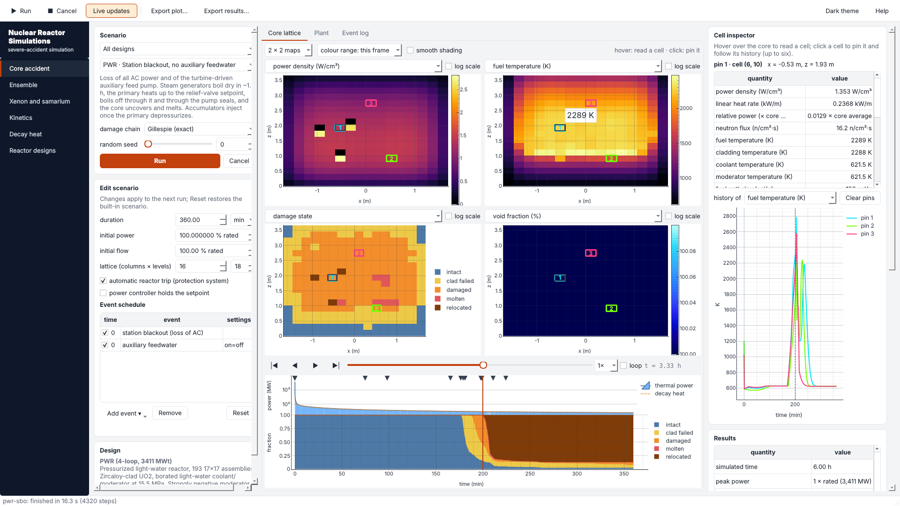

## Install and run

You need Python 3.9 or newer.

```bash
git clone https://github.com/gaschenb/Nuclear-Reactor-Simulations.git
cd Nuclear-Reactor-Simulations
pip install -r requirements.txt      # numpy, scipy, matplotlib, PyQt5, pyqtgraph
pip install -e .                     # optional: adds the reactorsim and reactorsim-gui commands
```

Then run one of these:

```bash
reactorsim-gui                       # desktop app   (or: python -m reactorsim.gui)
reactorsim run pwr-sbo               # one scenario from the command line   (or: python -m reactorsim)
```

## Features

1. **Eight reactor designs.** Each design carries its own geometry, rod and coolant data,
   six-group delayed-neutron data for its fission mix, generation time, feedback coefficients,
   poison cross sections and damage thresholds. `reactorsim reactors` prints the full table.

   | key | design | coolant / moderator | fuel | what makes it interesting |
   |---|---|---|---|---|
   | `pwr` | 4-loop PWR, 3411 MWt [14] | H₂O / H₂O | UO₂, Zircaloy | soluble boron, negative void and moderator coefficients, axial xenon oscillations |
   | `bwr` | BWR/4-type, 2381 MWt [15] | boiling H₂O | UO₂, Zircaloy | void feedback dominates, RCIC and isolation condenser, ADS |
   | `rbmk` | RBMK-1000 as in 1986 [16, 17] | boiling H₂O / graphite | UO₂, Zr–Nb | positive void coefficient, graphite displacers on the rod tips (positive scram), long Λ |
   | `rbmk-mod` | RBMK after the post-1986 fixes [16] | boiling H₂O / graphite | UO₂ | void coefficient about +0.7 β, more absorbers, faster rods |
   | `candu` | CANDU-6-type, 2064 MWt [18, 19] | D₂O / D₂O | natural UO₂ | positive coolant void, xenon poison-out, a separate moderator that boils off in a blackout |
   | `htgr` | prismatic modular HTGR, 350 MWt [20, 21] | He / graphite | TRISO | large graphite heat capacity, passive decay-heat removal by conduction |
   | `sfr-metal` | pool SFR, U–Pu–Zr metal fuel [22, 23] | Na | metal, HT9 | positive sodium void offset by fuel and radial expansion, inherent shutdown |
   | `sfr-oxide` | pool SFR, MOX [22] | Na | (U,Pu)O₂ | hotter fuel, larger void worth, sodium boiling in unprotected loss of flow |

2. **Thirty-three scenarios.** Every scenario exposes its timings and key inputs as parameters,
   and `t_end` sets the duration of any of them. In the app you can also move, change, switch off
   or add any event in a scenario.

   | key | scenario |
   |---|---|
   | `pwr-steady` | Steady full power |
   | `pwr-lbloca` | Large-break LOCA, ECCS available |
   | `pwr-lbloca-nolpi` | Large-break LOCA, low-pressure injection failed |
   | `pwr-sbloca-tmi` | Stuck-open relief valve, HPI throttled (1979-like) |
   | `pwr-sbo` | Station blackout, no auxiliary feedwater |
   | `pwr-sbo-afw` | Station blackout with turbine-driven feed until the batteries deplete |
   | `pwr-rod-ejection` | Control-rod ejection at hot zero power |
   | `pwr-xenon-osc` | Axial xenon oscillation |
   | `pwr-xenon-restart` | Trip and restart through the xenon pit |
   | `pwr-lof` | Loss of flow (pump trip) with scram |
   | `bwr-steady` | Steady full power |
   | `bwr-sbo-rcic` | Extended blackout, RCIC until DC power is lost (2011-like [24, 25]) |
   | `bwr-sbo-ic` | Blackout with the isolation condenser lost immediately |
   | `bwr-turbine-trip` | Turbine trip without bypass |
   | `bwr-recirc-trip` | Recirculation pump trip |
   | `bwr-lbloca` | Recirculation-line break with ADS and LPCI |
   | `rbmk-steady` | Steady full power |
   | `rbmk-1986` | Low-power test with void excursion and positive scram (1986-like [16]) |
   | `rbmk-xenon` | Xenon pit after a power reduction |
   | `rbmk-xenon-osc` | Radial-axial xenon instability |
   | `rbmk-mod-1986` | The same test after the post-1986 modifications |
   | `candu-steady` | Steady full power |
   | `candu-lbloca` | Large LOCA, void power pulse and shutdown system 1 |
   | `candu-loca-loecc` | LOCA with loss of emergency coolant injection |
   | `candu-sbo` | Station blackout, moderator boil-off |
   | `candu-poison-out` | Trip and xenon poison-out |
   | `htgr-steady` | Steady full power |
   | `htgr-dlofc` | Depressurized loss of forced cooling |
   | `htgr-plofc-atws` | Pressurized loss of forced cooling without scram |
   | `sfr-metal-steady` | Steady full power |
   | `sfr-metal-ulof` | Unprotected loss of flow (EBR-II-type test [23]) |
   | `sfr-metal-utop` | Unprotected transient overpower |
   | `sfr-oxide-ulof` | Unprotected loss of flow, oxide core |

3. **Stochastic core damage.** The damage chain is sampled exactly with the Gillespie method or
   approximately with τ-leaping. Relocated fuel carries its decay heat and enthalpy down the core
   and into the lower head.
4. **Monte Carlo ensembles.** An ensemble repeats a scenario with independent random streams and,
   if you want, sampled damage parameters, in parallel processes. It reports:
   1. the probability that each cell has failed, melted or relocated by any time, as a lattice
      map, along with the median time each cell gets there;
   2. median, 25–75 % and 5–95 % bands of the plant variables;
   3. the time of cladding failure, loss of geometry, first melt, relocation and vessel breach in
      every member;
   4. outcome probabilities with Wilson 95 % intervals [28], and the Spearman rank correlation [29]
      of any outcome with each uncertain input.
5. **Side calculations.** These cover xenon and samarium transients and the restart window,
   point-kinetics responses, the inhour relation, the Nordheim–Fuchs burst, ANS-5.1 decay heat
   and boil-off times.

## Methods

1. **Neutronics.** One-group diffusion on the x–z slice of the core,
   −∇·D∇φ + Σₐφ = (1/k) νΣ_f φ, gives the flux shape and k [1]. Between shape updates,
   reactivity changes are first-order perturbations on the current shape. The amplitude follows
   six-group point kinetics [2, 3], advanced exactly over each step with a matrix exponential
   (the quasi-static method). The shape is recomputed on a timer, after rod motion, and whenever
   the state has drifted far from it. Prompt-supercritical steps are limited to a few prompt
   periods.
2. **Poisons.** Each cell tracks I-135 → Xe-135 and Pm-149 → Sm-149, with fission yields for the
   design's fission mix, solved in closed form over each step [1]. The xenon pit after a trip,
   axial and radial xenon oscillations, xenon dead time and CANDU poison-out all come out of the
   lattice model without special handling. Samarium only builds up after shutdown.
3. **Feedback.** The model includes the following feedback terms:
   1. Doppler (∝ √T) and fuel axial expansion;
   2. moderator and coolant temperature (quadratic for light water);
   3. coolant void, with the design's sign;
   4. loss of moderation in dry LWR cells and in emptied CANDU moderator regions;
   5. radial core expansion driven by the inlet and outlet temperatures (SFR) [22];
   6. graphite displacers on the RBMK rod tips [16];
   7. soluble boron, diluted or added by injection;
   8. a reduced k∞ for molten and relocated debris that has lost the lattice geometry.
4. **Fuel and coolant.** Each cell has a fuel, cladding and moderator heat balance, solved
   implicitly. It uses temperature-dependent properties, gap conductance, melting with latent
   heat, and conduction and radiation between neighbouring cells.

   For water I use a forced-flow enthalpy march with subcooled and saturated boiling, drift-flux
   void, CHF (Zuber [11] with flow and void corrections), and transition and film boiling [10, 12].
   Rewetting uses the Groeneveld–Stewart minimum film-boiling temperature [13]. Once forced flow
   is lost, the core becomes a boiling pool with a two-phase mixture level, and uncovered cells
   are cooled only by superheated steam.

   Sodium cells exchange heat with the wall and can boil, with a vapour quality. Helium
   convection scales with density, so a depressurized HTGR is cooled only by conduction to the
   reactor cavity cooling system [20].
5. **Plant.** The plant model includes:
   1. the pressurizer and steam generators;
   2. homogeneous-equilibrium blowdown after a break, with critical flow and flashing [10];
   3. relief and safety valves;
   4. accumulators, HPI, LPI and ADS;
   5. RCIC and isolation condensers;
   6. auxiliary feedwater and battery depletion;
   7. ECC bypass in large cold-leg breaks;
   8. pump coast-down and natural circulation [14, 15].
6. **Decay heat, oxidation and release.** Decay heat follows ANS-5.1 (23 exponentials plus
   U-239 and Np-239) [4]. It is tracked per cell, so relocated fuel takes its decay heat with it.
   The app also compares it with the Way–Wigner fit [5].

   Zircaloy–steam oxidation uses Cathcart–Pawel below 1853 K [6] and Baker–Just above it [7]. It
   is limited by the steam that actually reaches uncovered cells, and the hydrogen and oxidation
   heat follow from it.

   Fission products are released from the gap when the cladding fails (NUREG-1465 [8]) and by
   CORSOR-M diffusion from hot fuel [9].
7. **Core damage chain.** Each fuel cell is a continuous-time Markov chain. Its transition hazards
   λ(T, ECR, H, state of the cell below) are recomputed from the deterministic state. The
   transitions are:
   1. cladding burst or creep rupture;
   2. PCMI failure in reactivity excursions;
   3. embrittlement by oxidation;
   4. loss of rod geometry;
   5. shattering on quench;
   6. liquefaction and melting;
   7. slumping into the cell below;
   8. refreezing into a crust;
   9. loss of support once the cell below has relocated.

   The jump process is sampled exactly with Gillespie's direct method, with the propensities
   recomputed after every event [26], or with τ-leaping [27].

   Relocation moves fuel mass, decay-heat inventory and enthalpy downward, eventually into the
   lower head, which can fail. In an energetic excursion, fragmented fuel is dispersed from the
   lattice, and boiling fuel in a superprompt excursion is expelled (core disassembly), which is
   what ends such bursts [2, 22].
8. **Ensemble statistics.** Members run in separate processes, each with its own random stream.
   Cell damage probabilities are fractions of members, and outcome intervals are Wilson score
   intervals [28]. Sensitivities are Spearman rank correlations between each sampled input and
   the outcome [29].

## Results

These are typical outcomes with the default seed:

1. `pwr-lbloca`: peak cladding temperature is about 850 K, with no cladding failure.
2. `pwr-sbo`: the steam generators dry out at about 1.2 h and the core uncovers at about 2.8 h.
   First melt comes at about 3.3 h and vessel breach at about 3.7 h, with about 460 kg of H₂.
3. `pwr-sbloca-tmi`: the core uncovers and makes about 470 kg of H₂. Molten material reaches the
   lower head, but the vessel holds.
4. `pwr-rod-ejection`: a prompt-critical burst of about 13× rated power, with fuel enthalpy
   about 30 cal/g and no failure.
5. `rbmk-1986`: a void excursion of about 14× rated power, then fuel fragmentation and melting.
6. `rbmk-mod-1986`: the same sequence, but power falls and there is no damage.
7. `candu-poison-out`: a restart 45 min after the trip fails. The adjusters are withdrawn and
   xenon still wins.
8. `htgr-dlofc`: fuel peaks at about 1520 K after about 4 days, far below the TRISO limit.
9. `sfr-metal-ulof`: power falls to the decay-heat level, with no sodium boiling.
10. `sfr-oxide-ulof`: the sodium boils, driving a void excursion and fuel disassembly.

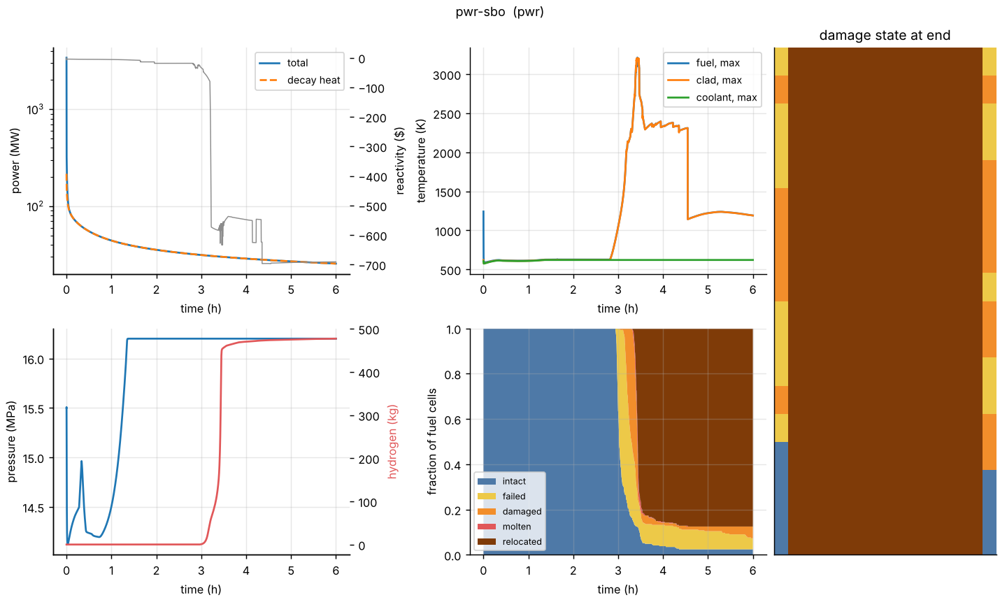

Damage states across the lattice during the blackout, at 2.8, 3.0, 3.2, 3.4 and 3.7 h:

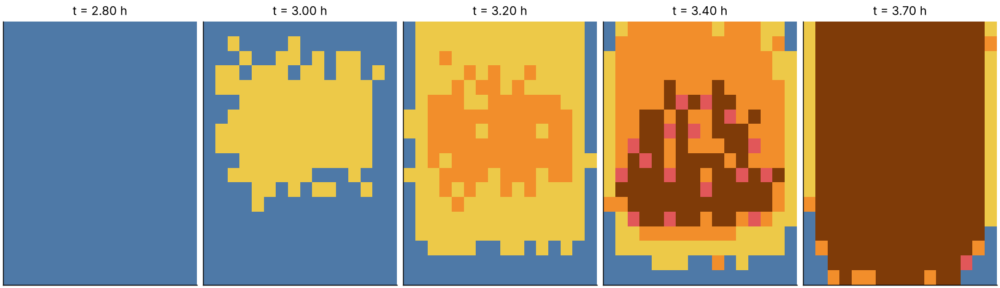

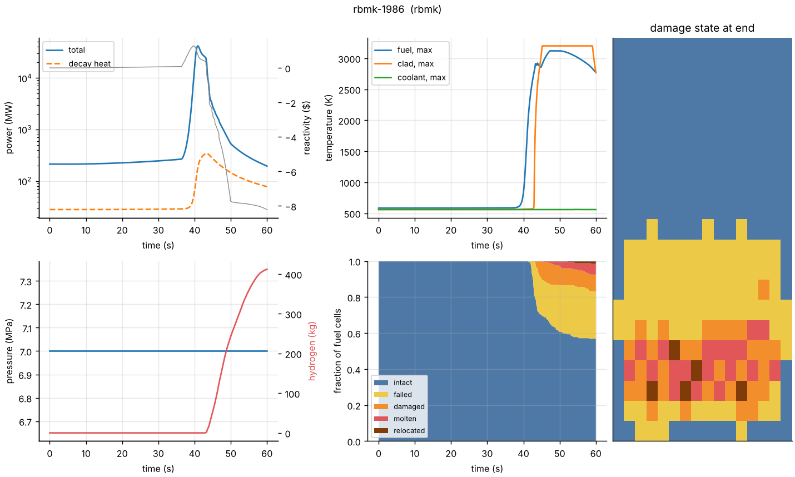

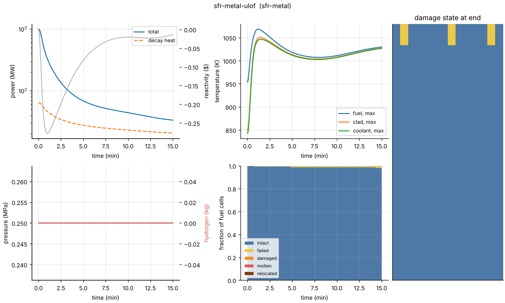

Axial xenon oscillation in a PWR, showing power density at 0, 10, 20, 30 and 40 % of the run:

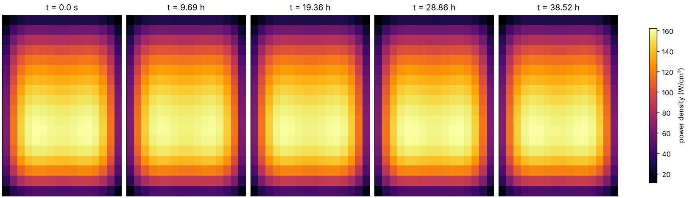

An ensemble of PWR blackouts:

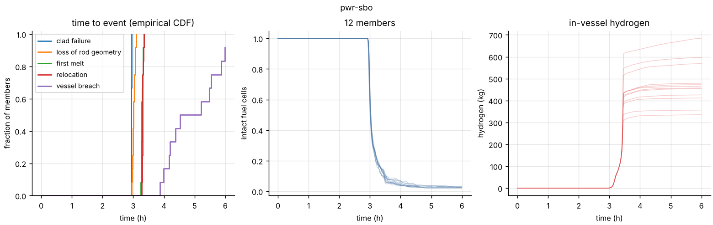

## GUI

The app has six workspaces in a sidebar, light and dark themes, and the equations typeset in the
window.

1. **Core accident.** Pick a design and a scenario and run it. The model runs in a worker thread
   and the lattice updates live.
   1. You can show up to four maps of the core cross-section, in physical units:
      1. power density (W/cm³) and linear heat rate (kW/m);
      2. neutron flux (n/cm²·s);
      3. fuel, cladding, coolant and moderator temperature (K);
      4. fuel enthalpy (cal/g) and void (%);
      5. I-135, Xe-135 and Sm-149 (atoms/cm³);
      6. the damage state and the Markov-chain transition rate λ (1/s);
      7. oxidation (% ECR), fuel mass (kg) and release (%).
   2. Every map has a log-scale switch. The colour range can follow each frame or stay fixed
      over the whole run. You can show one, two or four maps at a time, smoothed or not, and zoom
      in down to a single cell.
   3. Hovering over a cell reads out every quantity in it and highlights the same cell on all
      maps. Clicking pins up to six cells and plots their histories next to the maps.
   4. The timeline under the maps shows power, the damage stack and every event. You can drag
      or click its cursor, or play the run back at ¼× to 8×.
   5. The scenario editor changes the duration, initial power and flow, the protection system,
      the power controller, the lattice resolution, and the time and settings of every event.
      You can also add or remove events. For example, you can run the RBMK test for longer,
      scram earlier, or skip the pump coast-down.
   6. The plant tab plots power, the reactivity components, peak temperatures, pressure and
      coolant inventory, the damage fractions, hydrogen and release, with log axes for time and
      power. The event log jumps to any event.
2. **Ensemble.** This workspace shows the damage-probability maps, with playback through time,
   the percentile bands, event timing, and the outcome and sensitivity plots. It fills in as
   members finish.
3. **Xenon and samarium.** I, Xe, Pm and Sm transients after any power change, the restart window,
   and equilibrium xenon against power [1].
4. **Kinetics.** The point-kinetics response to a reactivity step, the inhour relation and the
   Nordheim–Fuchs burst [2].
5. **Decay heat.** ANS-5.1 against Way–Wigner, water boil-off without injection, and adiabatic
   heat-up [4, 5].
6. **Reactor designs.** Design data and a side-by-side comparison of the feedback coefficients.

Shortcuts are Ctrl+R to run, Esc to cancel, Ctrl+E to export the plot, Ctrl+Shift+E to export the
data as CSV, Ctrl+T to switch theme, and F1 for help.

This is the RBMK 1986-like test in the dark theme, at the peak of the excursion. It shows power
density on a log scale, neutron flux, and two pinned channels:

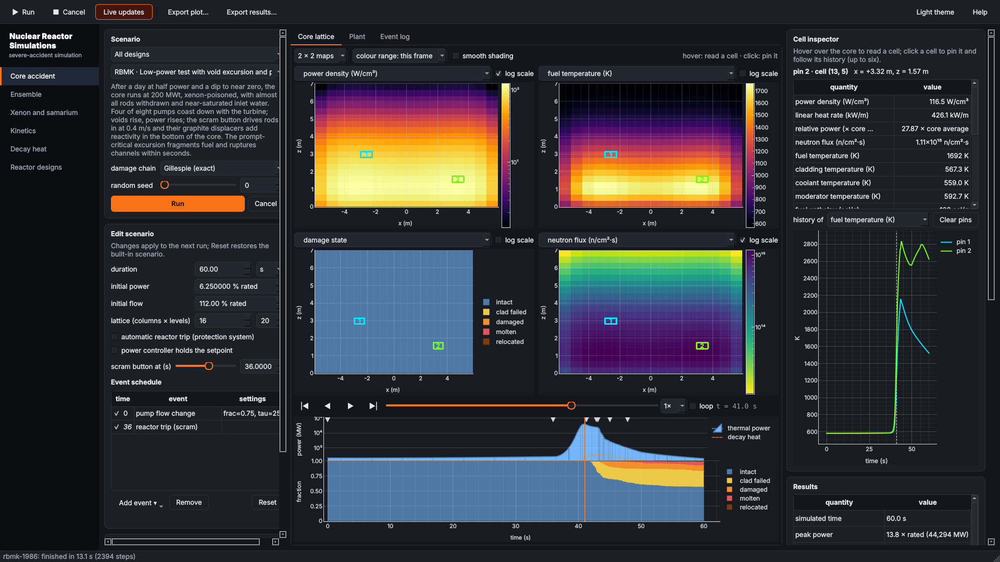

| | |
|---|---|
| 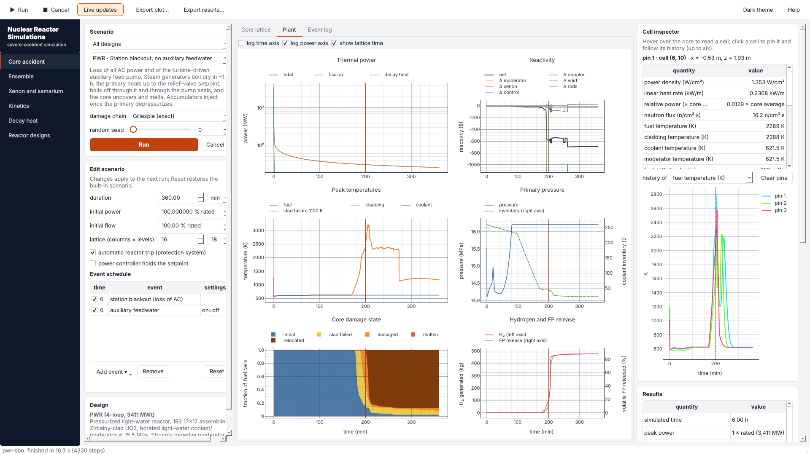 | 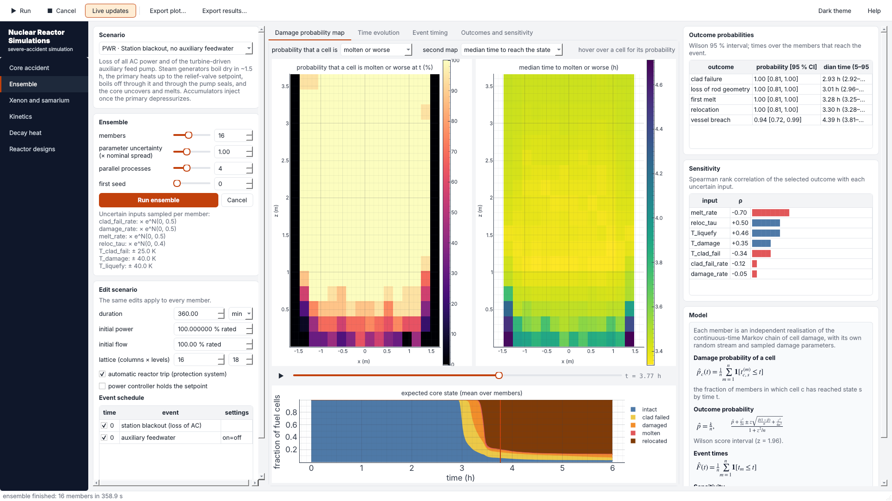 |
| 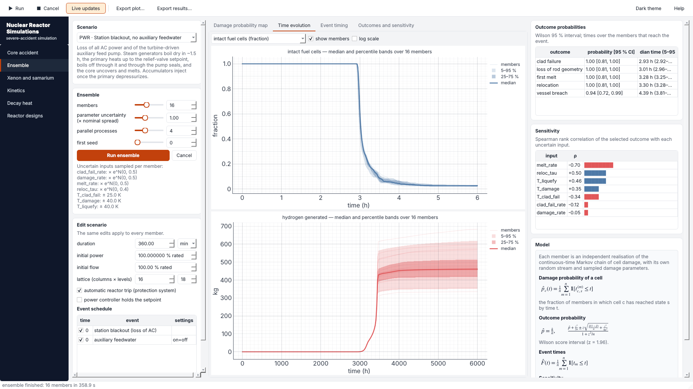 | 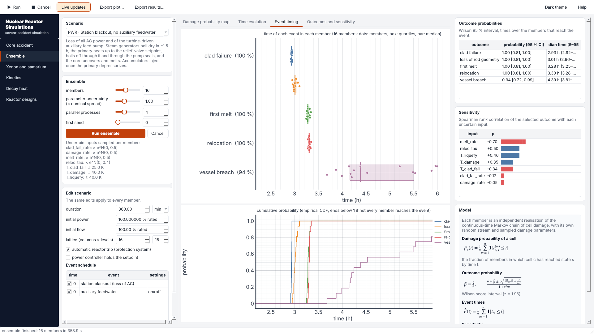 |
| 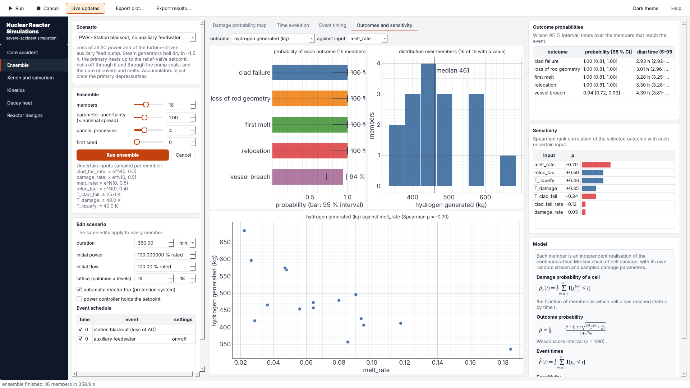 | 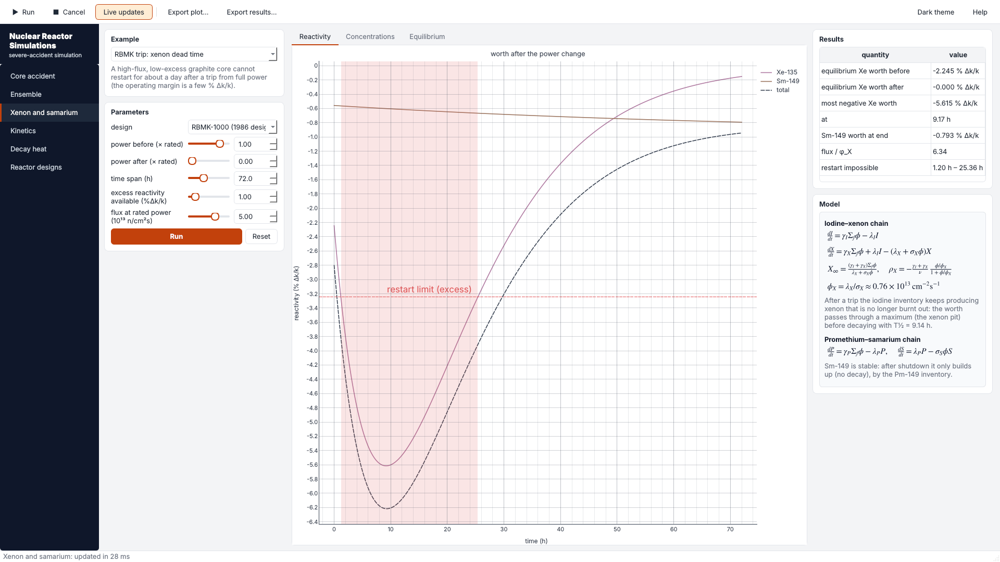 |
| 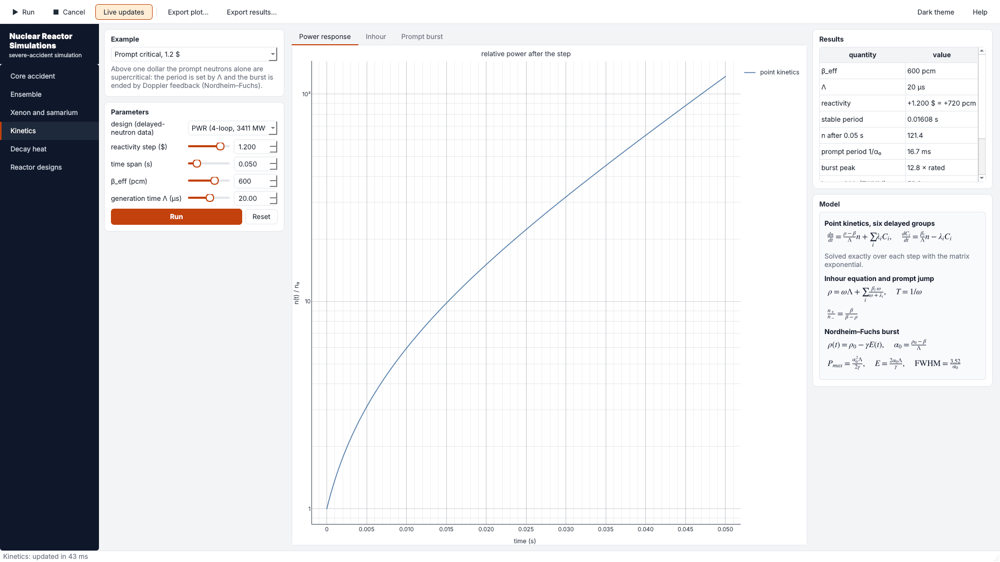 | |

## CLI

```bash
reactorsim reactors                                      # design data
reactorsim scenarios --reactor candu                     # scenario list
reactorsim run pwr-sbo --csv sbo.csv --png sbo.png       # one run: events, summary, time series
reactorsim run candu-poison-out -p t_restart=1200        # override a scenario parameter
reactorsim run rbmk-1986 -p t_end=180                    # change the duration of any scenario (s)
reactorsim ensemble pwr-sbo -n 32 --workers 6            # Monte Carlo ensemble
reactorsim xenon --reactor rbmk                          # xenon pit and restart window
reactorsim kinetics --reactor pwr --rho -1 0.3 1.2       # periods, prompt jump, prompt burst
reactorsim decay --days 500                              # ANS-5.1 decay heat
reactorsim boiloff --reactor bwr                         # time to uncover without injection
```

`reactorsim <command> --help` lists the options for each command.

## Library use

```python
from reactorsim import Simulator
from reactorsim.core.ensemble import run_ensemble

r = Simulator("pwr-sbo", seed=3).run()
r.summary["times"]                    # when each damage milestone happened (s)
r.series["H2"][-1]                    # hydrogen generated (kg)
r.at(3.5 * 3600).fields["state"]      # damage state of every cell at 3.5 h

e = run_ensemble("pwr-sbo", n=16, workers=4)
```

`Simulator` also takes `params={...}` to override scenario parameters, such as `t_end`.

## Layout

1. `reactorsim/core/` holds the model:
   1. `reactors.py`: the design data;
   2. `scenarios.py`: the built-in scenarios;
   3. `neutronics.py`: lattice diffusion and point kinetics;
   4. `depletion.py`: the poison chains and decay-heat precursors;
   5. `nuclear_data.py`: delayed-neutron, poison and decay-heat data;
   6. `materials.py`: material and coolant properties;
   7. `chemistry.py`: oxidation, hydrogen and fission-product release;
   8. `damage.py`: the Markov chain;
   9. `simulator.py`: the coupled model;
   10. `ensemble.py`: Monte Carlo ensembles;
   11. `analytics.py`: the closed-form models used by the side workspaces.
2. `reactorsim/gui/` holds the PyQt5 and pyqtgraph app:
   1. `app.py`: the main window;
   2. `sim_page.py` and `ensemble_page.py`: the two main workspaces;
   3. `lattice.py`: the live maps, timeline and cell inspector;
   4. `scenario_editor.py`: the scenario editor;
   5. the remaining `*_page.py` files: the xenon, kinetics, decay-heat and design workspaces.
3. `reactorsim/cli.py` is the command line, and `reactorsim/plots.py` makes the matplotlib
   figures it writes.
4. `examples/gallery.py` regenerates the figures in `docs/figures/`.

## Citations

1. J. J. Duderstadt and L. J. Hamilton, *Nuclear Reactor Analysis*, Wiley, 1976.
2. D. L. Hetrick, *Dynamics of Nuclear Reactors*, University of Chicago Press, 1971.
3. G. R. Keepin, *Physics of Nuclear Kinetics*, Addison-Wesley, 1965.
4. ANSI/ANS-5.1-1979, *Decay Heat Power in Light Water Reactors*, American Nuclear Society, 1979.
5. K. Way and E. P. Wigner, "The rate of decay of fission products," *Phys. Rev.* 73, 1318 (1948).
6. J. V. Cathcart et al., *Zirconium Metal–Water Oxidation Kinetics IV*, ORNL/NUREG-17, 1977.
7. L. Baker and L. C. Just, *Studies of Metal–Water Reactions at High Temperatures III*, ANL-6548, 1962.
8. L. Soffer et al., *Accident Source Terms for Light-Water Nuclear Power Plants*, NUREG-1465, 1995.
9. M. R. Kuhlman et al., *CORSOR User's Manual*, NUREG/CR-4173, 1985.
10. N. E. Todreas and M. S. Kazimi, *Nuclear Systems I: Thermal Hydraulic Fundamentals*, CRC Press.
11. N. Zuber, *Hydrodynamic Aspects of Boiling Heat Transfer*, AECU-4439, 1959.
12. W. H. Jens and P. A. Lottes, ANL-4627, 1951.
13. D. C. Groeneveld and J. C. Stewart, "The minimum film boiling temperature for water during film boiling collapse," *Proc. 7th Int. Heat Transfer Conf.*, 1982.
14. Westinghouse, *The Westinghouse Pressurized Water Reactor Nuclear Power Plant*, 1984.
15. US NRC, *Boiling Water Reactor (BWR) Systems*, technical training manual.
16. INSAG-1 (1986) and INSAG-7 (1992), *The Chernobyl Accident*, IAEA Safety Series 75.
17. E. Almenas, A. Kaliatka and E. Uspuras, *Ignalina RBMK-1500: A Source Book*, 1998.
18. B. Rouben, *CANDU Fuel Management and Reactor Physics*, UNENE course notes.
19. AECL, *CANDU 6 Technical Outline*.
20. US NRC, *Preapplication Safety Evaluation Report for the MHTGR*, NUREG-1338, 1989.
21. H. D. Gougar et al., HTGR technology course material, Idaho National Laboratory.
22. A. E. Waltar, D. R. Todd and P. V. Tsvetkov, *Fast Spectrum Reactors*, Springer, 2012.
23. H. P. Planchon et al., "Implications of the EBR-II inherent safety demonstration test," *Nucl. Eng. Des.* 101, 75 (1987).
24. R. O. Gauntt et al., *Fukushima Daiichi Accident Study*, SAND2012-6173, 2012.
25. INPO 11-005, *Special Report on the Nuclear Accident at the Fukushima Daiichi Nuclear Power Station*, 2011.
26. D. T. Gillespie, "Exact stochastic simulation of coupled chemical reactions," *J. Phys. Chem.* 81, 2340 (1977).
27. D. T. Gillespie, "Approximate accelerated stochastic simulation of chemically reacting systems," *J. Chem. Phys.* 115, 1716 (2001).
28. E. B. Wilson, "Probable inference, the law of succession, and statistical inference," *JASA* 22, 209 (1927).
29. C. Spearman, "The proof and measurement of association between two things," *Am. J. Psychol.* 15, 72 (1904).
